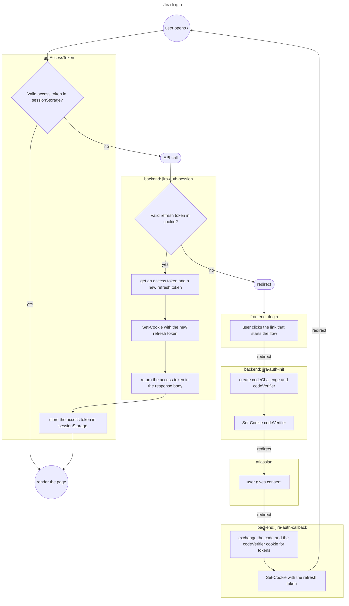

# Authentication

JiraSync logs in to two systems: Jira (Atlassian OAuth 2.0) and Bekk Timekeeper (Azure Entra ID). The two flows are independent of each other.

## Jira (Atlassian OAuth 2.0 with PKCE)

Jira login uses the OAuth 2.0 authorization code grant with PKCE. The token exchange runs in Netlify functions, so `JIRA_CLIENT_SECRET` never reaches the browser.

See Atlassian's docs on [OAuth 2.0 (3LO) apps](https://developer.atlassian.com/cloud/jira/platform/oauth-2-3lo-apps/).

### Function paths

The functions are served at Netlify's default paths, `/.netlify/functions/jira-auth-*`. The app, the functions and the fake backend all read them from `jiraAuthPaths` in `src/login/jira/authPaths.ts`, so refer to that rather than writing a path out. #27 moves them to stable `/api` routes (see [ADR 0006](adr/0006-the-backend-is-served-under-api-routes.md)).

| Function             | File                                | What it does                                                          |
| -------------------- | ----------------------------------- | --------------------------------------------------------------------- |
| `jira-auth-init`     | `src/backend/jira-auth-init.ts`     | Starts the flow: creates the PKCE verifier and redirects to Atlassian |
| `jira-auth-callback` | `src/backend/jira-auth-callback.ts` | Receives Atlassian's callback and exchanges the code for tokens       |
| `jira-auth-session`  | `src/backend/jira-auth-session.ts`  | Gets a new access token with the refresh token cookie                 |
| `jira-auth-logout`   | `src/backend/jira-auth-logout.ts`   | Deletes the refresh token cookie                                      |

### Flow



### Tokens in the browser

`src/login/jira/authContext.ts` manages the access token:

1. **Read:** looks for an access token in `sessionStorage`.
2. **Use the cached token** if it is valid for more than 60 more seconds. The margin keeps the token from expiring while a request is in flight.
3. **Refresh** if the token has expired or is about to: calls `jira-auth-session`, which uses the refresh token cookie to get a new access token and a new refresh token. Concurrent calls share one refresh request, because refresh tokens rotate and simultaneous refreshes would invalidate each other.
4. **Store** the new access token and its expiry in `sessionStorage`.

Access tokens last 1 hour. Refresh tokens last 90 days, live only in an httpOnly cookie, and can't be read from JavaScript.

#### A 401 from Jira

A token that looks valid locally can still be rejected by Jira, for example when it has been revoked, or when an old token is left in `sessionStorage` after the client ID or environment changed. On a 401, the Jira client (`src/data/jira/jiraclient.ts`) calls `invalidate()` to drop the cached token, gets a new one and retries the request once. If the retry fails too, the error goes to the caller. There is no automatic redirect to `/login`.

### Logout

`jira-auth-logout` deletes the refresh token cookie, and the client deletes the access token from `sessionStorage`.

### Scopes

- `read:jira-work`: read issues and worklogs
- `read:jira-user`: read user details
- `offline_access`: get a refresh token

### Configuration

- `JIRA_CLIENT_ID` and `JIRA_CLIENT_SECRET`: an Atlassian OAuth app with the scopes above. Set as environment variables in Netlify.
- `VITE_ATLASSIAN_CLOUD_ID`: the Cloud ID of the Jira Cloud site.
- `OVERRIDE_DEPLOY_URL`: the base URL the OAuth redirect returns to. Set it to `http://localhost:5173` locally. On Netlify, the deploy's own URL is used.

## Bekk (Azure Entra ID with MSAL)

Bekk login uses Azure Entra ID through MSAL (Microsoft Authentication Library). It runs entirely in the browser, with no server-side part.

### Flow

```
User opens the app
       │
       ▼
MsalAuthenticationTemplate checks for a login
       │  Not logged in? → redirect to the Azure login page
       ▼
Azure Entra ID login page
       │  User logs in with their Bekk account
       ▼
Redirect back to the app
       │  MSAL stores the tokens in localStorage
       │  and sets the active account
       ▼
The app is ready
```

### Setup (`src/login/bekk/bekkLogin.tsx`)

The MSAL instance is a module-level singleton (`msalInstance`) configured with:

- `clientId`: the app registration's client ID in Azure
- `authority`: `https://login.microsoftonline.com/{tenantId}`
- `cacheLocation`: `localStorage`

The `BekkEntraLogin` component wraps the app and redirects to the login page when needed. Components read the logged-in Bekk user with `useBekkAccount()`, which also works against the fake backend.

### Employee ID

`getEmployeeId()` reads the `employeeId` claim from the active MSAL account's ID token. The Bekk Timekeeper API uses it to identify the employee.

Call `getEmployeeId()` inside `queryFn`, not at the hook level: MSAL must have finished initialising.

### Token refresh

MSAL refreshes tokens through `acquireTokenSilent()`. The Bekk API client (`src/data/bekkclient.ts`) calls it in middleware before every request.

### Azure app registrations

| Environment | App registration                                                                                                                                                               |
| ----------- | ------------------------------------------------------------------------------------------------------------------------------------------------------------------------------ |
| Prod        | [97690193-50da-4eda-b961-519d047cc8ce](https://portal.azure.com/#view/Microsoft_AAD_RegisteredApps/ApplicationMenuBlade/~/Overview/appId/97690193-50da-4eda-b961-519d047cc8ce) |
| Dev         | [05d0e69d-bb21-43b6-bdd0-5eed364561c0](https://portal.azure.com/#view/Microsoft_AAD_RegisteredApps/ApplicationMenuBlade/~/Overview/appId/05d0e69d-bb21-43b6-bdd0-5eed364561c0) |

### Configuration

- `VITE_BEKK_ENTRA_TENANT_ID`: Azure tenant ID
- `VITE_BEKK_ENTRA_CLIENT_ID`: app registration client ID
- `VITE_BEKK_ENTRA_SCOPE`: API scope for Bekk Timekeeper
